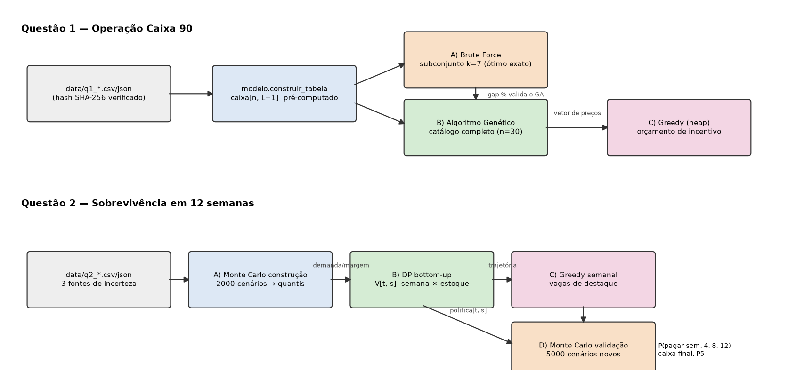

# avaliacao-varejo-grupo04 — Checkpoint 6 · Dynamic Programming (FIAP)

Recuperação financeira de varejistas por precificação online.

| | |
|---|---|
| **Grupo** | **G04** — Cesar Aaron Herrera, RM 565398 |
| **Seed base** | 8 |
| **Seed final** | 4008 (= 1000 × 4 + 8) |
| **ID da instância** | `464a09017fe0` |
| **SHA-256 do conjunto** | `464a09017fe0f26c561e5662d3f79f9b3bc7a4131c3a7a393250224f8d4c7ef8` |

> **Código do grupo.** O código G04 é o meu número na chamada. Se o código oficial for outro, troque `GRUPO` no Bloco 02 de `gerador/Gerador_Inputs_Checkpoint_6_G04.ipynb`, reexecute o notebook e copie a pasta gerada para `data/`. O restante do projeto lê o grupo do manifesto e não precisa mudar.

## Como reproduzir

Requisitos: Python 3.12.3. As dependências estão fixadas em `requirements.txt`.

```bash
python -m venv .venv && . .venv/bin/activate
pip install -r requirements.txt
./run_all.sh              # testes + Q1 completa + Q2 completa (~1 min)
```

Também é possível rodar cada parte separadamente:

```bash
python questao_01/main.py --modo completo
python questao_02/main.py --cenarios 5000 --modo completo
python -m pytest -q
```

Sem `--seed`, os dois `main.py` usam a `seed_final` do manifesto (4008). Toda parte aleatória recebe seed explícita:

| Componente | Seed |
|---|---|
| GA e subconjunto do BF | seed |
| MC de construção | seed + 1 |
| MC de validação | seed + 2 |

Executar de novo produz exatamente os mesmos números.

### Cenários-surpresa (apenas parâmetros, sem editar código nem dados)

| Alteração | Comando |
|---|---|
| Meta de caixa +10% | `python questao_01/main.py --meta-mult 1.10` |
| Dívidas +10% (Q2) | `python questao_02/main.py --divida-mult 1.10` |
| Concorrente −8% | `python questao_02/main.py --concorrente-mult 0.92` |
| Custo logístico +15% | `--custo-log-mult 1.15` (nas duas questões) |
| Orçamento promocional −25% | `--orcamento-mult 0.75` (nas duas questões) |
| SKU indisponível | `--remover-sku Q1-005` / `--remover-sku Q2-003` |
| GA: população / mutação | `python questao_01/main.py --ga-pop 200 --ga-mut 0.10` |

## Estrutura

```
data/                 instância oficial (cópia exata do notebook) + manifesto_dados.json
gerador/              notebook oficial (original e executado com o Bloco 02 do G04)
comum/                leitura + verificação SHA-256, medição de tempo/memória
questao_01/           brute_force.py, genetic_algorithm.py, greedy.py, modelo.py, main.py, resultados/
questao_02/           monte_carlo.py, dynamic_programming.py, greedy.py, main.py, resultados/
tests/                testes automatizados (pytest)
docs/                 arquitetura.png, complexidade.md, desempenho.md, decisoes.md
```



---

## Questão 1 — Operação Caixa 90

**Nesta questão utilizamos 3 algoritmos:**

1. **Brute Force** (`questao_01/brute_force.py::brute_force`)
   - Enumera todas as combinações de preços permitidos num subconjunto de 7 SKUs (92.160 combinações).
   - Produz o ótimo exato, que serve de benchmark.
2. **Algoritmo Genético** (`questao_01/genetic_algorithm.py::algoritmo_genetico`)
   - Roda primeiro no **mesmo subconjunto**, onde o gap em relação ao BF é calculado.
   - Depois roda no catálogo completo (30 SKUs).
   - Produz um vetor com o preço de cada SKU.
3. **Greedy** (`questao_01/greedy.py::alocar_incentivo`)
   - Recebe o **vetor de preços do GA**.
   - Distribui o orçamento de incentivo (cupom/cashback) pelo maior benefício marginal por real investido.

O fluxo é BF → valida o GA → GA → política de preços → Greedy. Os três consomem a mesma tabela `modelo.construir_tabela`.

### Resultados — `questao_01/resultados/`

| Evidência | Arquivo | Função que produz |
|---|---|---|
| Tabela Brute Force × GA (gap) | `q1_bruteforce_vs_ga.csv` | `main.etapa_brute_force_vs_ga` |
| Fitness por geração | `q1_fitness_por_geracao.png` | `main.executar` |
| Comparação de 2 configurações do GA | `q1_comparacao_ga.csv` | `main.executar` |
| Antes/depois do Greedy | `q1_politica_final.csv` (`unidades_antes/depois`, `beneficio_antes/depois`) | `greedy.alocar_incentivo` |
| Resumo financeiro | `q1_resumo.json` | `main.executar` |
| Escalabilidade | `q1_escalabilidade.csv` | `main.desempenho` |
| Otimização antes/depois | `q1_otimizacao_antes_depois.csv` | `modelo.avaliar_populacao(_loop)` |

**Brute Force × GA (subconjunto de 7 SKUs)**

| Método | Fitness (R$) | Avaliações | Gap |
|---|---|---|---|
| Brute Force | 70.957,56 | 92.160 | — |
| GA | 70.957,56 | 8.400 | **0,00%** |

**Resultado final (catálogo completo)**

| Métrica | Valor |
|---|---|
| Caixa da política do GA | R$ 389.152,88 |
| Caixa após o Greedy | **R$ 414.265,33** |
| Meta de caixa 90d | R$ 285.933,47 → **atingida, folga de R$ 128.331,86** |
| Cobertura da dívida (R$ 255.290,57) | **162,3%** |
| Margem operacional | 22,2% |
| Estoque remanescente | 1.047 un. (21,1% do inicial) |
| Uso do orçamento promocional | R$ 86.540,11 de R$ 86.606,61 (99,9%) |
| SKUs com desconto / limite | 4 / 9 |
| SKUs suspensos (sem preço com margem mínima) | 5 |

**Análise financeira**

- **Meta e dívida.** A política do GA sozinha já cobre a meta (R$389 mil contra R$286 mil) e a dívida.
- **Como o GA chega lá.** A política sobe o preço dos SKUs de demanda pouco elástica e usa os poucos descontos permitidos onde o giro de estoque antigo compensa.
- **SKUs suspensos.** Cinco SKUs vendem com prejuízo em qualquer nível. Suspender a venda desses SKUs evita queimar caixa.
- **Incentivo.** O incentivo gera R$25,1 mil de caixa adicional e reduz o estoque parado, mas custa R$86,5 mil: cada R$1 investido devolve R$0,29 de caixa.
  - Se a verba promocional já estiver provisionada (por exemplo, verba de marketing ou do fornecedor), vale aplicá-la como o Greedy indica.
  - Se ela sair do caixa da dívida, a recomendação é não usá-la (`razao_minima=1.0`). Ver `docs/decisoes.md`.

## Questão 2 — Plano de Sobrevivência em 12 Semanas

**Nesta questão utilizamos 3 algoritmos** (o Monte Carlo aparece duas vezes):

1. **Monte Carlo — construção** (`questao_02/monte_carlo.py::estatisticas_construcao`)
   - Simula 2000 cenários com três fontes de incerteza: demanda, preço do concorrente e custo logístico.
   - Estima, para cada SKU e nível de preço, os quantis de demanda e a margem média.
2. **Programação Dinâmica** (`questao_02/dynamic_programming.py::dp_sku`)
   - Estado: (semana, estoque restante).
   - Decisão: nível de preço.
   - Transição: estoque menos `min(estoque, quantil de demanda do MC)`.
   - Objetivo: maximizar a contribuição esperada.
   - Implementação bottom-up. A reutilização de subproblemas ocorre em `V[t+1]`: cada estado é consultado ~39 vezes.
   - O caminho ótimo é reconstruído por `trajetoria_esperada`.
3. **Greedy** (`questao_02/greedy.py::alocar_destaques`)
   - Recebe a **trajetória de preço e estoque da DP**.
   - Escolhe a cada semana os até 4 SKUs com maior ganho esperado por real para receber destaque ou mídia.
4. **Monte Carlo — validação** (`questao_02/monte_carlo.py::validar_plano`)
   - O plano completo volta a ser testado em **5000 cenários novos** (seed diferente).
   - O preço é escolhido de forma adaptativa: `politica[t, estoque_real]`.

### Resultados — `questao_02/resultados/`

| Evidência | Arquivo | Função |
|---|---|---|
| Estatísticas do MC que alimentam a DP | `q2_estatisticas_mc.csv` | `estatisticas_construcao` |
| Trajetória semanal (todos os SKUs) | `q2_trajetoria_dp.csv` | `dp_sku` + `trajetoria_esperada` |
| Trajetória de produtos representativos | `q2_trajetoria_preco_estoque.png` | `main.graficos` |
| Destaques escolhidos pelo Greedy | `q2_destaques_greedy.csv` | `alocar_destaques` |
| Distribuição do caixa final | `q2_distribuicao_caixa_final.png`, `q2_caixa_semanal.png` | `main.graficos` |
| Probabilidades e métricas de risco | `q2_validacao.csv`, `q2_resumo.json` | `validar_plano` + `resumir_validacao` |
| Estresse (onde a falha começa) | `q2_estresse_divida.csv` | `main.estresse` |
| Escalabilidade (3+ tamanhos) | `q2_escalabilidade.csv` | `main.escalabilidade` |

**Validação (5000 cenários independentes)**

| Métrica | Plano MC→DP→Greedy | Preço fixo 1,00 |
|---|---|---|
| P(pagar semana 4 — R$ 114.905) | 100% | 100% |
| P(pagar semana 8 — R$ 148.419) | 100% | 100% |
| P(pagar semana 12 — R$ 215.447) | 100% | 100% |
| Caixa final esperado | **R$ 305.007** | R$ 111.667 |
| Caixa final P5 (percentil de risco escolhido) | **R$ 297.660** | R$ 106.854 |
| Margem operacional | 31,7% | 24,5% |
| Estoque final médio | 647 un. | 366 un. |
| Cenários com falha | 0 | 0 |

**Estresse de dívida (`q2_estresse_divida.csv`)**

| Dívidas × | P(pagar todas) — plano | P(pagar todas) — preço fixo |
|---|---|---|
| 1,0 | 100% | 100% |
| 1,2 | 100% | 100% |
| 1,4 | 100% | **0%** |
| 1,5 | 100% | 0% |
| 1,6 | 99,95% | 0% |
| 1,8 | **0%** | 0% |

**Análise financeira**

- **Risco na instância original.** Com as dívidas originais, as duas políticas pagam tudo. O limite de risco de 10% é respeitado com folga.
- **Ganho do plano.** O plano da DP gera **R$193 mil a mais** de caixa final. O P5 de R$298 mil indica baixa dispersão.
- **Onde aparece a diferença.** O estresse mostra a diferença real entre as políticas:
  - o preço fixo quebra (falha na semana 12) quando as dívidas sobem 40%;
  - o plano aguenta até ~60% a mais;
  - a falha só começa perto de 1,8×.
- **Custo da estratégia.** O plano sobe preços e mantém mais estoque no final (647 contra 366 unidades). Ele troca giro por margem, o que é aceitável aqui porque o caixa das três parcelas está garantido.
- **Destaques.** O Greedy usou 48 destaques (4 por semana), com R$24,6 mil gastos. O fator que limita é o número de vagas, não o orçamento.

## Big O, desempenho e testes

- **Big O de cada algoritmo:** `docs/complexidade.md`. Para cada um há as variáveis, o trecho dominante e o ponto em que deixa de ser viável.
- **Medições:** `docs/desempenho.md`. O tempo vem de `time.perf_counter` e a memória de `tracemalloc`, em entradas pequena, média e grande. Inclui a otimização antes/depois (~479× no fitness do GA).
- **Testes:** `tests/` (21 testes). Cobrem:
  - integridade dos hashes e detecção de arquivo alterado;
  - reprodução do caixa base do gerador;
  - BF em caso pequeno conhecido;
  - GA = BF no subconjunto;
  - reprodutibilidade por seed;
  - DP comparada a uma recursão direta;
  - limites do greedy (vagas e orçamento);
  - SKU inexistente;
  - estoque nunca negativo;
  - dívida impagável.
